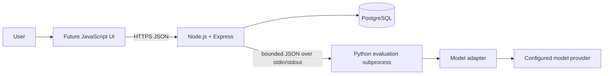

# Agent Arena Architecture

**Status:** Python evaluation engine and Milestone 6a persistence foundation are implemented. The API includes owner-scoped dataset/version and model-configuration resources. Evaluation-run persistence and the Python subprocess protocol remain future work.

## Goals and boundaries

The first persistent backend should be one JavaScript/Express application backed by PostgreSQL and the existing Python evaluation package. It is a modular application, not a set of services. The browser talks only to Node. Node owns HTTP validation, caller ownership checks, orchestration, and all database writes. Python owns adapter invocation, metric calculation, and evaluation result production. PostgreSQL is the durable record of datasets, model configurations, runs, and results.

No Python process connects to PostgreSQL. Node loads immutable inputs, invokes Python, validates the response envelope, and persists the returned result in a transaction. The Python engine remains usable independently of the API.

## Initial run lifecycle

The planned run integration (Milestone 6b) uses synchronous, bounded evaluation for local development and small datasets:

1. Node authenticates or resolves a trusted caller principal, validates the request, and loads an owned immutable dataset version and model configuration.
2. Node creates an `evaluation_runs` row in `running` state with snapshots of evaluator and execution settings.
3. Node starts one Python subprocess with a fixed executable/argument list and sends a versioned JSON request on stdin. It enforces a configured wall-clock timeout and bounds input, output, and concurrency.
4. Python validates the request again, uses the existing `EvaluationRunner` and adapter contract, and returns versioned JSON containing per-example and aggregate results.
5. Node validates the response shape and run/result associations, then stores results and terminal run status in one transaction. Node does not recalculate metric scores or denominators.

The process boundary is not a security sandbox. Use `shell: false`, fixed program arguments, a controlled working directory, a restricted environment, and no shell interpolation. Pass only environment variables required by the selected adapter; never pass secrets in JSON or log stdin/stdout. Capture stderr with a size bound and keep it out of API responses. Kill the child on timeout or client disconnect and persist a safe failure status. A malformed response, nonzero exit, or timeout is a run-level failure; an adapter failure for one example remains an item error if Python returns a valid result.

Node validates public HTTP input and output protocol envelopes. Python independently validates its input using its own contracts (including dataset and JSON Schema validation), since subprocess input is still an untrusted boundary. Node checks that returned IDs correspond exactly to the submitted ordered records, metric fields have expected types, and aggregate counts are internally plausible; it does not become a second evaluator.

The current Python package has no CLI/protocol wrapper or general provider registry; it exposes the evaluation library and deterministic mock adapter. The subprocess wrapper and a deliberately small adapter selection mechanism must be implemented before API-triggered runs. Milestone 6a accepts only the registered local mock model configuration and rejects credential profiles. Future provider credentials remain backend configuration: model records may hold an allowlisted credential-profile reference, while secret values are supplied to the child through a restricted runtime environment. A request cannot choose arbitrary environment variable names or return credential values.

## Alternatives considered

| Approach | Benefits | Costs | Decision |
|---|---|---|---|
| Python HTTP service | Long-lived process, independent deployment/scaling, natural network API | Another service to deploy, authenticate, monitor, version, and secure; duplicates process/network failure modes | Defer until independent scaling or remote execution is justified |
| Node-invoked Python subprocess | One deployment unit; explicit per-run timeout and exit status; no internal network endpoint; uses the existing Python library directly | Process startup and serialization overhead; Python runtime must be installed beside Node; concurrency/resource limits require care | Use initially |

For small bounded evaluations, background jobs are not required for the first vertical slice. Synchronous execution keeps persistence and failure handling visible without adding a queue or worker. It must have strict request-size, example-count, per-call, whole-run, and concurrency limits. Before workloads can exceed HTTP/proxy timeouts or need durable execution after an API restart, move run execution to a database-backed worker (roadmap Milestone 7); do not add Redis or a message broker by default.

## Persistence, ownership, and data lifecycle

PostgreSQL is the source of truth. Dataset versions, their records, and model configurations are append-only: database triggers reject row updates/deletes and table truncation. Production uses a schema-owner migration role separately from the restricted API runtime role, which has no trigger/schema DDL or delete/truncate rights. A run snapshots evaluator configuration, metric identity as returned by Python, schema contents/digest, and effective non-secret execution settings. Results and run metrics are append-only. Mutable display labels and the dataset's latest-version pointer do not alter prior run inputs.

Every user-owned resource carries an `owner_id`. Authentication is outside the first storage feature: use a minimal principal row keyed by an identity-provider issuer/subject, with no password or token storage in Agent Arena. Until a real provider is integrated, production requests fail closed; development may use a fixed allowlist only when both `NODE_ENV=development` and an explicit development-auth flag are set. Never accept a client-supplied `owner_id` as proof of identity. Every lookup and mutation scopes by the principal resolved at the identity-provider boundary. Keep ownership checks in application queries and foreign keys; PostgreSQL row-level security and organization/role models are deferred until tenancy requirements justify them.

Do not store provider secrets in model JSON, run snapshots, results, logs, or API responses. Persist only a credential profile reference. Secret storage and per-user credential onboarding remain deployment decisions. Dataset inputs, references, and model outputs may contain sensitive data: restrict result access by owner and define retention, deletion, backup, and encryption policies before production use.

## Failure and security behavior

Persist item outcomes separately from run state. Exact-match and JSON Schema failures are scored outcomes; adapter errors are unscored item errors under the current Python denominator semantics. A process crash, invalid protocol response, persistence failure, or whole-run timeout fails the run. Store stable error categories and sanitized messages only. Never pass provider exception strings directly to API responses. The Python `ModelAdapterError` currently can carry a message, so Node must treat it as untrusted and map it to an allowlisted public error code/message.

Custom endpoints create SSRF risk. Before supporting them, restrict schemes, addresses, redirects, DNS resolution, and egress; credentials must not be sent to a caller-selected host without explicit policy. Enforce request, response, output, and stderr size limits. Do not put raw prompts, outputs, or provider errors in application logs by default.

Authentication method, secret manager, data retention, custom endpoint policy, and deployment topology are unresolved and should be decided before production exposure.
