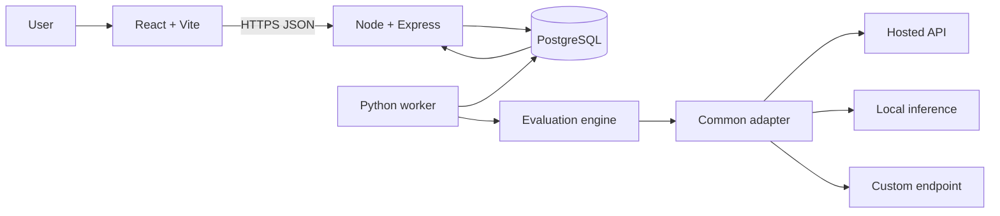

# Agent Arena Architecture

**Status: proposed.** Planning target only; repository contains no source or README.

## System overview

React/Vite calls a JavaScript/Express API. Node owns authentication, resource APIs, experiment orchestration, and persistence. PostgreSQL is the system of record. A Python evaluation library owns adapters, execution, and scoring; a Python worker claims runs from PostgreSQL and stores results. Begin with database leases; add a queue when measured needs justify it.

## Adapter and OOP design

Use a Python adapter contract with normalized input (prompt/messages, settings, timeout) and output (text, model/provider ID, usage if available, safe metadata). Adapters contain provider-specific auth, request/response parsing, and error translation. Encapsulation keeps credentials/client details behind controlled interfaces. Abstraction is the adapter/evaluator contract. Polymorphism lets hosted, local, and custom endpoints run through one evaluator. Prefer composition for transport, retry, and usage helpers; inheritance is optional and justified only for genuinely shared invariants.

## Lifecycle and failure handling

Validate ownership and compatibility when creating an experiment. In one transaction create it and a queued run snapshotting model/config version, dataset and suite versions, evaluators, and execution settings. A worker atomically claims by lease, runs examples, stores item outcomes and metrics, then records succeeded, completed_with_errors, failed, or cancelled. API serves status and paginated results; UI initially polls. Set connect, attempt, example, and whole-run timeouts; bound concurrency/output. Retry only transient repeat-safe errors with capped backoff. Record sanitized errors and attempt counts. Expired leases allow recovery; idempotent result keys prevent duplicates. Cancellation is cooperative. Never log secrets or raw provider errors.

## Protection and scope

Enforce ownership in API queries and relations. Validate uploaded format, size, encoding, and rows; keep dataset versions immutable. Restrict data/results, encrypt transport, protect credentials via secret management, redact them, and never return secret values. Disclose external model data transfer. Retention, deletion/export, at-rest encryption, and tenant isolation need later requirements.

MVP: one Node API, PostgreSQL, one Python engine/worker, versioned datasets/suites, a few generic evaluators, compatible model endpoints, run tracking/results, authentication and ownership. Deferred: dedicated queue/scaled workers, agents/tools, controlled failures, advanced robustness, live updates, billing, complex administration, provider-specific features, and deployment decisions.
