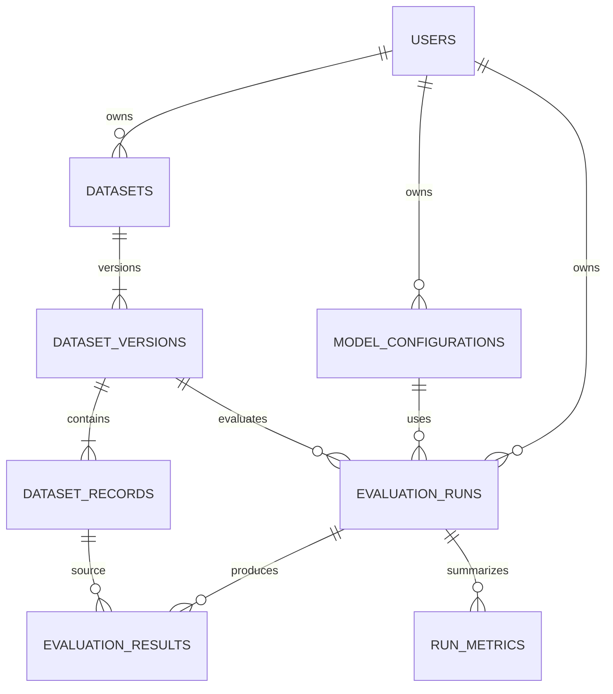

# Proposed PostgreSQL Model

**Status:** Milestone 6a migrations implement `users`, `datasets`, `dataset_versions`, `dataset_records`, and `model_configurations`. The `evaluation_runs`, `evaluation_results`, and `run_metrics` tables below remain proposed for Milestone 6b. No live PostgreSQL integration test has been run in this environment.

Use UUID primary keys for resources, `timestamptz` UTC timestamps, JSONB only for versioned configuration/metric detail, and ordinary columns for keys used in joins, filtering, and constraints. Proposed indexes are listed per table; add further indexes only from measured query plans.

## Tables

### `users`

Minimal ownership principal mapped from a future authentication provider; it is not a home-grown authentication system.

- **Columns:** `id uuid primary key`, `issuer text not null`, `subject text not null`, `created_at timestamptz not null`.
- **Constraints:** unique `(issuer, subject)`; issuer and subject non-empty.
- **Indexes:** the unique identity index serves identity lookup.
- No passwords, access tokens, or provider credentials belong here. If a deployment has only one trusted local principal, it can seed one row.

### `datasets`

Logical user-visible dataset identity and mutable name/latest-version pointer.

- **Columns:** `id uuid primary key`, `owner_id uuid not null references users(id)`, `name text not null`, `latest_version_id uuid null`, `created_at`, `updated_at`.
- **Constraints:** non-empty name; unique `(owner_id, name)` if the API adopts names as unique. `latest_version_id` must reference a version belonging to this dataset (composite FK or application transaction check).
- **Indexes:** `(owner_id, updated_at desc, id)` for listing.
- Rename and latest-version pointer may change. Neither changes existing version rows.

### `dataset_versions`

Immutable validated snapshot of a dataset's format and provenance.

- **Columns:** `id uuid primary key`, `dataset_id uuid not null references datasets(id)`, `version integer not null`, `format_version text not null`, `record_count integer not null`, `content_digest char(64) not null`, `metadata jsonb not null default '{}'`, `created_at timestamptz not null`.
- **Constraints:** unique `(dataset_id, version)` and `(dataset_id, id)`; positive version and record count; digest format checked by application (optionally a SQL check).
- **Indexes:** the unique `(dataset_id, version)` index supports version lookup and ordered reads.
- A changed record set creates a new version. Store records relationally in `dataset_records`, not as a large JSONB array or opaque file in this first design. For the initial dataset API, compute `content_digest` as lowercase SHA-256 of UTF-8 compact JSON for the ordered list of normalized `{id,input,reference,metadata}` objects; omitted metadata normalizes to `{}`; object keys at every nesting level are sorted recursively while array order and string values are preserved. This digest contract belongs to the Node dataset format and does not change Python's evaluation semantics. Database triggers reject `UPDATE`, `DELETE`, and `TRUNCATE` on version rows and their records.

### `dataset_records`

Ordered records belonging to one immutable dataset version.

- **Columns:** `id uuid primary key`, `dataset_version_id uuid not null references dataset_versions(id)`, `ordinal integer not null`, `example_id text not null`, `input text not null`, `reference text not null`, `metadata jsonb not null default '{}'`.
- **Constraints:** unique `(dataset_version_id, ordinal)` and `(dataset_version_id, example_id)`; ordinal is non-negative; `example_id` and `input` are non-empty. Empty references remain allowed, matching Python validation.
- **Indexes:** `(dataset_version_id, ordinal)` (the unique index covers ordered reads).
- Order and IDs preserve the current Python dataset contract. Database triggers reject `UPDATE`, `DELETE`, and `TRUNCATE`; changes require a new dataset version.

### `model_configurations`

One immutable, owner-scoped configuration that a run can reference. Editing effective settings creates a new configuration ID; no separate model catalog or version table is needed yet.

- **Columns:** `id uuid primary key`, `owner_id uuid not null references users(id)`, `name text not null`, `adapter_type text not null`, `provider_id text not null`, `model_id text not null`, `endpoint text null`, `settings jsonb not null default '{}'`, `credential_profile text null`, `created_at timestamptz not null`.
- **Constraints:** non-empty name/type/provider/model; unique `(owner_id, name)` while active if names are API-unique. `settings` is validated against the selected adapter's allowlisted options. `credential_profile` is a server-side identifier, never a secret value.
- **Indexes:** `(owner_id, created_at desc, id)` and an active-name uniqueness strategy if required.
- Database triggers reject `UPDATE`, `DELETE`, and `TRUNCATE` on model rows. To retire a configuration, the initial API can leave it readable for history and disallow new runs by policy; archive/delete behavior is deferred. Credential profile secret values may rotate outside PostgreSQL; that limits exact reproducibility and must be recorded as an operational limitation, never as secret material.

### `evaluation_runs`

Durable run request, status, and reproducibility snapshot. A run references exact immutable inputs and copies the effective safe configuration used at launch.

- **Columns:** `id uuid primary key`, `owner_id uuid not null references users(id)`, `dataset_version_id uuid not null references dataset_versions(id)`, `model_configuration_id uuid not null references model_configurations(id)`, `state text not null`, `evaluator_snapshot jsonb not null`, `model_snapshot jsonb not null`, `execution_snapshot jsonb not null`, `request_hash char(64) not null`, `idempotency_key text not null`, `error_code text null`, `safe_error_message text null`, `started_at timestamptz null`, `finished_at timestamptz null`, `created_at timestamptz not null`.
- **Constraints:** state in `running`, `succeeded`, `completed_with_errors`, `failed`, `cancelled`; unique `(owner_id, idempotency_key)`; nonnegative lifecycle rules; ownership compatibility for referenced dataset and model must be enforced by application query/transaction and can be reinforced with composite owner foreign keys.
- **Indexes:** `(owner_id, created_at desc, id)` for prior runs; `(owner_id, state, created_at desc)` for status filtering.
- Snapshots contain evaluator type/schema, effective non-secret generation settings, adapter/model identifiers, and relevant format versions. They never contain credential values. Dataset rows are immutable, so the version FK is itself a stable content reference.

### `evaluation_results`

One metric outcome for one dataset record in a run. The first API selects one evaluator per run, matching the current runner methods.

- **Columns:** `id uuid primary key`, `run_id uuid not null references evaluation_runs(id)`, `dataset_record_id uuid not null references dataset_records(id)`, `ordinal integer not null`, `example_id text not null`, `metric_name text not null`, `metric_version text not null`, `outcome text not null`, `score double precision null`, `passed boolean null`, `actual_output text null`, `duration_seconds double precision not null`, `schema_version text null`, `schema_digest char(64) null`, `failure_reason text null`, `error_code text null`, `safe_error_message text null`, `details jsonb not null default '{}'`.
- **Constraints:** unique `(run_id, example_id, metric_name, metric_version)`; outcome in `scored`, `adapter_error`, `evaluation_error`; a scored outcome has score/passed, while an adapter error has null score/passed; duration is nonnegative. Verify the referenced record belongs to the run's dataset version in the Node transaction (or add a composite FK using the run's dataset version).
- **Indexes:** `(run_id, ordinal)` for stable pagination and `(run_id, metric_name, metric_version)` for metric filtering.
- Metric identity is stored per item. JSON Schema runs also persist the dialect and canonical schema digest on each item. `details` contains metric-specific booleans such as `json_valid` and `schema_valid`, not a second source of score truth.
- Store actual model output only because users need per-example inspection; it may be sensitive and must follow owner access and retention rules. Raw provider errors and stack traces are never stored.

### `run_metrics`

Aggregate metric value and coverage for a run; separate rows allow future runs to report more than one metric without introducing metric-definition management tables.

- **Columns:** `id uuid primary key`, `run_id uuid not null references evaluation_runs(id)`, `metric_name text not null`, `metric_version text not null`, `value double precision null`, `denominator integer not null`, `metadata jsonb not null default '{}'`, `schema_version text null`, `schema_digest char(64) null`.
- **Constraints:** unique `(run_id, metric_name, metric_version)`; denominator and metadata counts are nonnegative; `value` is null when no items were scored. Metadata records total/scored/pass/fail/error counts and structured validity counts.
- **Indexes:** unique run/metric index supports retrieval.
- There is no `metric_definitions` table initially: names and versions are defined by the Python engine, while each result persists the returned identity/version. Add a registry only if definitions become user-configurable or need independent lifecycle/queries.

## Relationships and invariants

Creation of a dataset version and all its records is one transaction; only after inserts and digest/count verification does the dataset's latest pointer move. Run creation saves a unique idempotency key and request hash before invoking Python. Repeating the same owner/key/body returns the existing run; the same key with a different hash is a conflict. Result rows plus run metrics and terminal state are committed atomically after the subprocess response is validated. If execution fails, persist a safe failed state without partial scored results unless partial-result semantics are deliberately added later.

Exact-match denominator remains the number of scored outputs; adapter failures are excluded, and `value` is null if the denominator is zero. `json_schema_validity` is a separate metric with its own denominator and schema digest. Persist the engine-provided score and counts; Node does not recompute them.

## Migrations and deferred choices

The current backend uses ordered SQL files under `backend/src/db/migrations/` and a small in-repository migration runner. It takes a PostgreSQL advisory lock, applies each file transactionally, records its SHA-256 checksum, skips unchanged applied files, and rejects changed or missing applied migrations. Migration `002_immutable_history.sql` adds triggers that reject row updates/deletes and table truncation for `dataset_versions`, `dataset_records`, and `model_configurations`. Run migrations explicitly as a deployment step (`npm run migrate`), not on API startup. Add new numbered files and never edit an applied migration; test the runner with doubles and verify SQL against PostgreSQL before release.

The migration role owns the schema and may create/alter tables and triggers. The API should connect with a separate runtime role that is not an owner and has no schema/trigger DDL, `DELETE`, or `TRUNCATE` privileges. Grant it `USAGE` on the schema; `SELECT` and `INSERT` on `users`, `datasets`, `dataset_versions`, `dataset_records`, and `model_configurations`; column-level `UPDATE` on only `datasets.latest_version_id` and `datasets.updated_at`; and `EXECUTE` on `reject_immutable_history_mutation()`. Do not grant table-level `UPDATE` on `datasets` or any update privilege on immutable tables. The trigger guards ordinary DML; separation from the owner role prevents the runtime from replacing or disabling the triggers. Use the migration role only for `npm run migrate`, then set `PGUSER`/`PGPASSWORD` to the runtime role for `npm start`.

Before production decide PostgreSQL major version, authentication identity source, retention/deletion, backup/restore, encryption, secret manager, and the exact mechanism enforcing same-owner foreign references. Dataset content digests use lowercase SHA-256 of UTF-8 compact JSON for the ordered normalized `{id,input,reference,metadata}` record objects; metadata keys are recursively sorted, arrays and strings are preserved, and missing metadata becomes `{}`. Defer suites/experiments, traces, audit event tables, soft-delete policy, tenant/RLS policy, and worker lease tables until requirements call for them.
